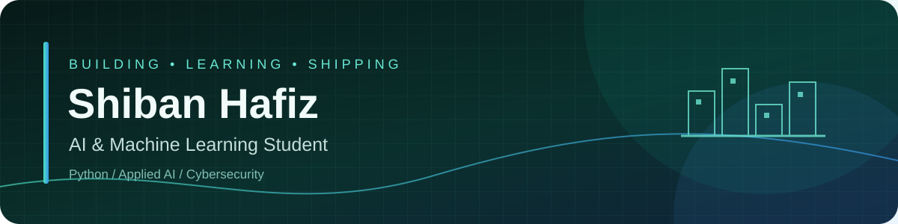
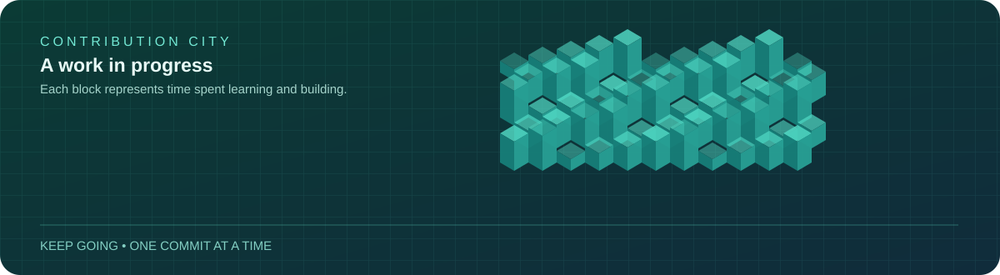
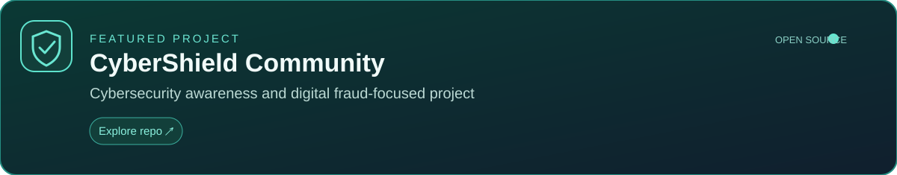

 

---

## The city I built this year

  

Every contribution is a building block. Keep learning, keep shipping.

## Population

  
  

## Landmarks

  

### Featured project

**[CyberShield Community](https://github.com/Shibanhafiz/CyberShield-Community)**  
A cybersecurity-focused project exploring ways to help people recognize digital fraud and suspicious activity. Visit the repository for the current implementation and documentation.

## A little about me

I'm **Shiban Hafiz**, a second-year B.E. Artificial Intelligence and Machine Learning student at AITM, Bhatkal. I enjoy learning by building practical projects and steadily improving my development skills.

- **Currently learning:** Python, AI/ML fundamentals, Git and GitHub
- **Interested in:** Applied AI, cybersecurity, and useful developer tools
- **Goal:** Build reliable projects, learn in public, and prepare for internships

## Tech I work with

## Find me

---

  Designed in a clean teal-on-dark style · No GitSkins embeds or watermarks · Stats cards are served by GitHub Readme Stats.

